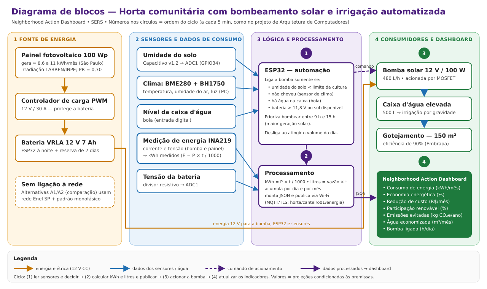
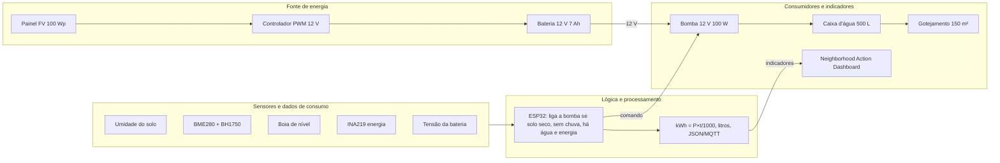

# Horta Comunitária Solar — Neighborhood Action Dashboard

**Global Solution 2026.2 • CitizenTech • Contribuição da disciplina Soluções em Energias Renováveis e Sustentáveis (SERS)**
Ciência da Computação — Turma 1CCPB — FIAP

| Integrante | RM |
|---|---|
| Daniel Rodrigues Pegoretti de Almeida | 574898 |
| Gabriel Oliveira Fernandes da Costa | 574826 |

**Dashboard:** abra o arquivo `index.html` no navegador ou publique este repositório no GitHub Pages (seção [Como executar](#9-como-executar)).
**Vídeo:** _link do vídeo não listado no YouTube_

> Todos os valores de economia, geração renovável e redução de impactos são **projeções condicionadas às premissas** de
> [`dados/premissas.csv`](dados/premissas.csv), e não resultados garantidos.

---

## Sumário
1. [Diagnóstico do problema](#1-diagnóstico-do-problema)
2. [Solução proposta](#2-solução-proposta)
3. [Dados utilizados e fontes](#3-dados-utilizados-e-fontes)
4. [Estimativas de consumo e cálculos](#4-estimativas-de-consumo-e-cálculos)
5. [Comparação das alternativas](#5-comparação-das-alternativas)
6. [Diagrama conceitual](#6-diagrama-conceitual)
7. [Indicadores energéticos e ambientais](#7-indicadores-energéticos-e-ambientais)
8. [Integração ao Neighborhood Action Dashboard](#8-integração-ao-neighborhood-action-dashboard)
9. [Como executar](#9-como-executar)
10. [Estrutura do repositório](#10-estrutura-do-repositório)
11. [Referências e limitações](#11-referências-e-limitações)
12. [Uso de IA](#12-uso-de-ia)

---

## 1. Diagnóstico do problema

| Item | Descrição |
|---|---|
| **Espaço comunitário** | Horta comunitária de bairro em São Paulo (SP), com cerca de 150 m² de canteiros (≈ 30 canteiros de 1 × 5 m). |
| **Problema energético** | A irrigação costuma ser feita com uma bomba de 1/2 cv (370 W) ligada à rede e controlada por timer: ela liga todo dia no mesmo horário, inclusive em dias de chuva, e é regulada para o mês mais quente. Isso gasta energia e água à toa. Além disso, muitas hortas ficam em terrenos sem ligação elétrica: para ter energia é preciso instalar um padrão de entrada (≈ R$ 1.800) e pagar no mínimo 30 kWh/mês (custo de disponibilidade), mesmo que a bomba consuma só ≈ 6 kWh/mês. |
| **Público beneficiado** | Moradores e voluntários que cultivam a horta (famílias responsáveis pelos canteiros), escolas e vizinhos que recebem ou compram os alimentos, e a associação de bairro que paga as contas. |
| **Condições de funcionamento** | Clima de São Paulo (irradiação média de 4,7 kWh/m²·dia no plano inclinado; 110 dias de chuva por ano), caixa d'água elevada de 500 L, irrigação por gotejamento por gravidade, bombeamento preferencialmente entre 9 h e 15 h. |
| **Benefícios esperados** | Irrigar sem conta de luz e sem depender da rede, gastar menos água, dar à comunidade dados de consumo e de geração no dashboard e usar a horta como exemplo prático de energia solar. |

**Pergunta orientadora:** como usar energia solar, eficiência e monitoramento para irrigar a horta gastando menos energia, menos água e menos dinheiro?

## 2. Solução proposta

Bombeamento **solar fotovoltaico off-grid** com **irrigação automatizada**:

- painel de **100 Wp** + controlador de carga PWM + bateria 12 V 7 Ah;
- bomba de diafragma **12 V / 100 W** (480 L/h) que enche uma caixa d'água elevada; a horta é irrigada por gotejamento por gravidade;
- **ESP32** com os sensores do projeto de Arquitetura de Computadores (umidade do solo capacitivo, BME280, BH1750), mais boia de nível e sensor de energia **INA219**. O ESP32 só liga a bomba quando o solo está seco, não choveu, há água e há energia;
- o ESP32 calcula kWh e litros e publica os dados via MQTT; o **Neighborhood Action Dashboard** mostra os indicadores.

A proposta foi comparada com duas alternativas que usam a rede elétrica (seção 5).

## 3. Dados utilizados e fontes

| Arquivo | Conteúdo | Fonte |
|---|---|---|
| [`dados/irradiacao_labren_sp.csv`](dados/irradiacao_labren_sp.csv) | Irradiação diária média mensal no plano inclinado, São Paulo (ponto 5728: −23,50; −46,65) | LABREN/CCST/INPE — Atlas Brasileiro de Energia Solar, 2ª ed. |
| [`dados/clima_inmet_sp.csv`](dados/clima_inmet_sp.csv) | Dias de chuva ≥ 1 mm, precipitação e temperatura média por mês | INMET — Normais climatológicas 1991–2020, Mirante de Santana |
| [`dados/premissas.csv`](dados/premissas.csv) | Todas as premissas (área, ETo, tarifa, equipamentos, preços) com a fonte ou justificativa de cada uma | Embrapa, ANEEL/Enel SP, MCTI, catálogos e lojas online |
| [`dados/resultados.json`](dados/resultados.json) | Resultados gerados pelo script (usados pelo dashboard) | `calculos/calculos_energia.py` |

Tarifa usada: R$ 725,18/MWh (B1 Enel SP 2025, sem tributos) × 1,0897 (reajuste de 2026 na baixa tensão) × 1,298 (tributos) = **R$ 1,03/kWh**.

## 4. Estimativas de consumo e cálculos

Os cálculos estão em [`calculos/calculos_energia.py`](calculos/calculos_energia.py), que usa apenas Python 3. Período de referência: **ano típico**, com resultados por mês.

**Passo 1 — Água necessária por dia (L/dia).** A evapotranspiração de cada mês foi estimada proporcionalmente à irradiação, a partir da ETo média de 4,4 mm/dia:

```
ETo_mês  = 4,4 mm/dia × (irradiação do mês ÷ irradiação média anual)
Água/dia = ETo_mês × Kc ÷ eficiência × área = ETo_mês × 1,0 ÷ 0,90 × 150 m²     (1 mm × 1 m² = 1 L)
```
Exemplo de fevereiro: ETo = 4,4 × 5,239 ÷ 4,671 = 4,93 mm/dia → 4,93 ÷ 0,90 × 150 = **822 L/dia** (mês de pico). A média do ano é 733 L/dia.

**Passo 2 — Tempo de bomba e energia** com a fórmula do enunciado, **E = P × t / 1000**:

| Alternativa | Como irriga | Exemplo (fevereiro, 28 dias, 14 com chuva) |
|---|---|---|
| A1 — Timer fixo | 822 L todos os dias | t = 822 ÷ 1.500 L/h = 0,548 h → E = 370 × 0,548 / 1000 = 0,203 kWh/dia × 28 = **5,68 kWh** |
| A2 — Rede + sensores | só nos 14 dias sem chuva | 0,203 kWh × 14 dias + ESP32 (0,5 W × 24 h × 28 / 1000 = 0,336 kWh) = **3,18 kWh** |
| A3 — Solar + sensores | só nos 14 dias sem chuva | t = 822 ÷ 480 = 1,713 h → E = 100 × 1,713 / 1000 = 0,171 kWh × 14 + 0,336 = **2,73 kWh** |

**Passo 3 — Geração solar** do painel: `E_pv = 0,100 kWp × irradiação × PR (0,70) × dias`. Em fevereiro: 0,1 × 5,239 × 0,70 × 28 = **10,27 kWh**, contra 2,73 kWh de consumo. Em todos os meses a geração (8,6 a 11,0 kWh) supera o consumo da A3 (2,5 a 4,8 kWh): o pior mês tem folga de 2,2 vezes.

**Passo 4 — Custo.** Na rede, a fatura cobra o maior valor entre o consumo e o custo de disponibilidade (30 kWh/mês para ligação monofásica): 30 × R$ 1,03 = **R$ 30,77/mês** para A1 e A2. A A3 não paga energia; o custo dela é a troca da bateria a cada 3 anos (R$ 100 ÷ 36 = R$ 2,78/mês).

**Passo 5 — Emissões:** energia da rede (kWh/ano) × 0,0247 kg CO₂/kWh (fator médio do SIN, MCTI).

A tabela mês a mês está em [`docs/tabelas_resultados.md`](docs/tabelas_resultados.md).

## 5. Comparação das alternativas

Mesma necessidade (irrigar 150 m²) e mesmo período de referência (ano típico).

| Indicador | A1 Convencional (rede + timer) | A2 Eficiência (rede + sensores) | A3 Renovável (solar + sensores) |
|---|---|---|---|
| Consumo de energia | 6,17 kWh/mês | 4,17 kWh/mês | **3,58 kWh/mês** |
| Economia de energia vs. A1 | — | 32,4% | **42,0%** |
| Energia comprada da rede | 74,1 kWh/ano | 50,1 kWh/ano | **0** |
| Água aplicada | 25,0 m³/mês | **15,4 m³/mês** | **15,4 m³/mês** |
| Custo de operação | R$ 30,77/mês | R$ 30,77/mês | **R$ 2,78/mês** |
| Investimento, horta que já tem energia | **R$ 250** | R$ 360 | R$ 1.594 |
| Investimento, horta sem energia (inclui padrão de entrada) | R$ 2.050 | R$ 2.160 | **R$ 1.594** |
| Participação renovável | 0% | 0% | **100%** |
| Emissões | 1,83 kg CO₂e/ano | 1,24 kg CO₂e/ano | **0** |
| Viabilidade técnica | Simples; exige ponto de energia e vistoria da Enel | Exige ponto de energia e conexão Wi-Fi/celular | Não depende da rede; exige sol entre 9 h e 15 h e caixa elevada |
| Impactos ambientais | Mais água (irriga na chuva) e emissões da rede | Menos água e energia; ainda usa a rede | Zero emissão na operação; descarte correto de bateria e painel no fim da vida útil |
| Benefícios | Menor preço de compra | Economia de água; dados no dashboard | Sem conta de luz; funciona sem rede; dados no dashboard; uso educativo |
| Limitações | Conta mínima de 30 kWh/mês | A economia de energia não reduz a conta (custo de disponibilidade) | Maior investimento se já houver energia; bomba menor; risco de furto do painel |

**Conclusão da comparação.**
- **Horta sem energia:** a A3 custa R$ 456 a menos já na implantação e elimina a conta mensal.
- **Horta que já tem energia:** o investimento extra da A3 (R$ 1.344) se paga em cerca de **48 meses** com a economia de R$ 27,99/mês.
- **A2:** economiza 32% de energia e 38% de água, mas **não reduz a conta**, porque o consumo continua abaixo da cobrança mínima de 30 kWh. Esse é um resultado importante da análise: em cargas pequenas, só sair da rede reduz o custo.
- **Emissões:** são pequenas em todos os casos, porque a matriz elétrica brasileira é majoritariamente renovável. O ganho ambiental mais relevante é a **água**: 9,6 m³/mês a menos.

## 6. Diagrama conceitual



Versão vetorial: [`docs/diagrama_solucao.svg`](docs/diagrama_solucao.svg).



## 7. Indicadores energéticos e ambientais

Valores da A3 (proposta) comparados com a A1. Todos vêm do script de cálculo e aparecem no dashboard.

| Indicador | Unidade | Valor projetado | Como é calculado / medido |
|---|---|---|---|
| Consumo de energia | kWh/mês | 3,58 | Σ (P × t / 1000) da bomba e do ESP32; em operação, medido pelo INA219 |
| Economia energética estimada | % | 42,0 | 1 − consumo A3 ÷ consumo A1 |
| Redução estimada de custos | R$/mês | 27,99 | custo A1 − custo A3 |
| Participação de energia renovável | % | 100 | energia solar usada ÷ energia consumida |
| Emissões evitadas estimadas | kg CO₂e/ano | 1,83 | energia da rede evitada × fator do SIN |
| Água economizada | m³/mês | 9,6 | água A1 − água A3 |
| Tempo de funcionamento da bomba | h/dia | 1,06 (média) | litros do dia ÷ vazão da bomba |

Detalhes em [`docs/indicadores.md`](docs/indicadores.md).

## 8. Integração ao Neighborhood Action Dashboard

O dashboard ([`index.html`](index.html)) é a contribuição de SERS ao projeto integrador. Ele mostra:

- **cartões de indicadores**, para alternar entre A3 e A2 em relação à A1;
- **gráficos mensais** de energia, geração solar e água;
- **tabela de comparação** quantitativa e qualitativa das alternativas;
- **simulador**: ao mudar a área, a tarifa, a potência do painel ou o PR, os indicadores são recalculados com as mesmas fórmulas do Python (`assets/calculos.js`);
- **monitoramento** com dados simulados no formato de mensagem MQTT do ESP32 (mesmo padrão do projeto de Arquitetura de Computadores, com os campos de energia);
- **diagrama** da solução, além das **premissas e fontes**.

O dashboard lê `dados/resultados.js`, que é gerado pelo script Python. Assim, os indicadores correspondem exatamente aos cálculos da seção 4.

**Integração com outras disciplinas.** A parte de hardware reaproveita o ESP32, os sensores e o envio por MQTT projetados em *Arquitetura e Organização de Computadores* (Sistema Preditivo de Irrigação com IoT). A **contribuição específica de SERS** está em: análise de consumo, dimensionamento do sistema solar, comparação das alternativas, indicadores energéticos e ambientais e o dashboard deste repositório.

## 9. Como executar

1. **Recalcular os indicadores** (opcional; os resultados já estão no repositório):
   ```bash
   python calculos/calculos_energia.py
   ```
   O script lê `dados/*.csv` e gera `dados/resultados.json`, `dados/resultados.js` e `docs/tabelas_resultados.md`. Para testar outro cenário, altere `dados/premissas.csv` e rode de novo.
2. **Abrir o dashboard:** dê dois cliques em `index.html`. Ele funciona sem servidor e sem internet.
3. **Publicar no GitHub Pages:** em *Settings → Pages*, escolha a branch `main` e a pasta `/ (root)`. O dashboard fica em `https://<usuario>.github.io/<repositorio>/`.

## 10. Estrutura do repositório

```
├── index.html                    # Neighborhood Action Dashboard (módulo SERS)
├── assets/
│   ├── calculos.js               # fórmulas do simulador (iguais às do Python)
│   ├── dashboard.js              # gráficos, indicadores, tabelas e monitoramento
│   └── style.css
├── calculos/calculos_energia.py  # estimativas de consumo, geração, custos e indicadores
├── dados/
│   ├── premissas.csv             # premissas com fonte/justificativa
│   ├── irradiacao_labren_sp.csv  # LABREN/INPE
│   ├── clima_inmet_sp.csv        # INMET
│   ├── resultados.json / .js     # gerados pelo script
├── docs/
│   ├── diagrama_solucao.svg/.png # diagrama de blocos
│   ├── tabelas_resultados.md     # tabelas geradas pelo script
│   ├── indicadores.md
│   └── referencias_e_limitacoes.md
└── video/roteiro_video.md        # roteiro do vídeo de até 3 minutos
```

## 11. Referências e limitações

As referências completas, com links, e a lista de limitações estão em [`docs/referencias_e_limitacoes.md`](docs/referencias_e_limitacoes.md). Principais limitações:

- **Necessidade de água:** a ETo de cada mês foi estimada proporcionalmente à irradiação, sem usar o método completo de Penman-Monteith.
- **Chuva:** considera-se que cada dia com chuva ≥ 1 mm dispensa a irrigação daquele dia.
- **Preços:** os valores de equipamentos são referências de lojas online em nov/2026 e variam.
- **Desempenho real:** vazões, PR e consumo do ESP32 são premissas e devem ser confirmados com medição (INA219) após a instalação.
- **Monitoramento:** os dados dessa seção do dashboard são simulados.

## 12. Uso de IA

- **O que a IA fez:** verificou a confiabilidade das fontes de dados e verificou se o cálculo estava correto.
- **O que os estudantes fizeram:** escolheram o espaço comunitário (horta) e a cidade de referência, pesquisaram fontes de dados e definiram a integração com o projeto de Arquitetura de Computadores, escreveram o script de cálculo, o dashboard e o diagrama, revisaram os dados, os cálculos e as premissas; gravaram o vídeo; publicaram o repositório.
